# MoneyFollow: Requirements Specification

| | |
|---|---|
| **Product** | MoneyFollow (home finance app) |
| **Platforms** | Android and iOS (Flutter); HTML prototype for UX validation |
| **Document version** | 1.0 (draft) |
| **Date** | 14 November 2026 |
| **Repository** | https://github.com/developerahmedrabie/Ebtkar.MoneyFollow |
| **Prototype** | [`prototype/index.html`](../prototype/index.html) (open in any browser) |

---

## Contents

1. [Introduction](#1-introduction)
2. [Users and roles](#2-users-and-roles)
3. [Glossary](#3-glossary)
4. [Feature overview](#4-feature-overview)
5. [Functional requirements](#5-functional-requirements)
6. [Calculations and business rules](#6-calculations-and-business-rules)
7. [Screens](#7-screens)
8. [Data model](#8-data-model)
9. [External services](#9-external-services)
10. [Non-functional requirements](#10-non-functional-requirements)
11. [Production app: requirements beyond the prototype](#11-production-app-requirements-beyond-the-prototype)
12. [Open decisions](#12-open-decisions)
13. [Acceptance checklist](#13-acceptance-checklist)
14. [Appendix A: reference lists](#appendix-a-reference-lists)

---

## 1. Introduction

### 1.1 Purpose

This document describes what MoneyFollow must do and how each screen looks and behaves. It is the reference for building the Flutter app in `src/` and for testing it. The HTML prototype in `prototype/` implements every requirement marked **Prototype: ✅** and is the visual reference for the screens.

### 1.2 Product vision

MoneyFollow helps a family track its income and expenses and **see what is coming** before it happens:

- **Track** day-to-day income and expenses, in any currency, for each family member.
- **Plan** recurring bills and income, monthly budgets, and yearly occasions such as Ramadan, the Eids and Christmas.
- **Predict** the next months' spending from recurring items, past behaviour and what each occasion cost in previous years.
- **Understand** where the money goes: by category, by family member and over time.

The app is Arabic-first with full right-to-left (RTL) support, and is fully usable in English.

### 1.3 Scope

| In scope | Out of scope (for version 1) |
|---|---|
| Income and expense tracking | Bank account syncing / open banking |
| Recurring items with due dates | Bill payment from inside the app |
| 3- and 6-month forecast | Investments, loans and debt tracking |
| Monthly budgets per category | Receipt scanning (OCR) |
| Family members and per-member history and forecast | Tax reports |
| Yearly occasions with dates from public APIs and cost prediction | |
| Multi-currency with exchange rates | |
| Reports, CSV export | |
| Arabic / English, RTL, light / dark theme | |
| Local on-device database; sync between devices through Google Drive | Own backend server (no server is needed) |

---

## 2. Users and roles

| Role | Description | Can do |
|---|---|---|
| **Parent** (father or mother) | Manages the family's money. Main user of the app. | Everything: add family members, record expenses for any member, set budgets, recurring items and occasions, see all reports. |
| **Child** | A family member whose spending is tracked (pocket money, school, activities). | In the prototype a child has no login; the parent records their expenses. See §11 for child accounts in the production app. |
| **Other** | Any other household member (grandparent, domestic helper, etc.). | Same as Child. |
| **Whole family** | Not a person. A built-in bucket for shared spending (rent, groceries, utilities). | Always exists and cannot be deleted. |

---

## 3. Glossary

| Term | Meaning |
|---|---|
| **Transaction** | A single income or expense with an amount, currency, category, date, account, member and optional occasion. |
| **Recurring item** | A bill or income that repeats weekly, monthly, every 3 months or yearly, with a next due date. |
| **Main currency** | The currency all totals, budgets, reports and forecasts are shown in. |
| **Fixed bills** | Expenses that come from recurring items. |
| **Day-to-day spending** | All other expenses (not recurring, not tagged with an occasion). |
| **Occasion** | A yearly event that changes spending: Ramadan, Eid al-Fitr, Eid al-Adha, Christmas, etc. |
| **Occurrence** | One year's instance of an occasion (for example Ramadan 2027, starting 8 Feb 2027). |
| **Forecast** | Expected income, spending and savings for each of the next 3 or 6 months. |
| **Selected month** | The month the user is viewing. Changed with the ‹ month › control at the top of several screens. |

---

## 4. Feature overview

| # | Feature | Summary | Prototype |
|---|---|---|---|
| F1 | Transactions | Add, edit, delete, search and filter income and expenses. | ✅ |
| F2 | Categories and accounts | 16 fixed built-in categories plus the user's own categories (add / edit / delete from Settings); Cash, Bank, Card and Dollar accounts. | ✅ |
| F3 | Multi-currency | Each transaction keeps its own currency; everything is converted to the main currency. | ✅ |
| F4 | Recurring items | Bills and income that repeat, with due dates and "Mark paid". | ✅ |
| F5 | Forecast | Next 3 or 6 months: fixed bills + occasions + day-to-day, income and savings. | ✅ |
| F6 | Budgets | Monthly spending limit per category with progress and warnings. | ✅ |
| F7 | Family members | Add members, assign spending to them, see each member's history and forecast. | ✅ |
| F8 | Yearly occasions | Occasion dates from public APIs, tagging, cost prediction from previous years. | ✅ |
| F9 | Reports | Monthly KPIs, category donut, 6-month trend, spending by member. | ✅ |
| F10 | Localization | Arabic (RTL) and English, switchable at any time. | ✅ |
| F11 | Settings and data | Theme, language, main currency, exchange rates, CSV export, demo reset. | ✅ |
| F12 | Local database and Google Drive sync | All data in a local database on the phone; devices sync through the user's Google Drive. | ❌ (Flutter app only) |

---

## 5. Functional requirements

Priority: **M** = must have, **S** = should have, **C** = could have.

### 5.1 Transactions (F1)

| ID | Requirement | Priority |
|---|---|---|
| FR-TX-01 | The user can add a transaction from the **+** button in the bottom navigation, from any screen. | M |
| FR-TX-02 | A transaction has: type (Expense / Income), amount, currency, category, member ("For"), occasion (expenses only, optional), date, account and note. | M |
| FR-TX-03 | Amount must be greater than 0 and a category must be chosen. Otherwise the sheet shows "Enter an amount greater than 0" or "Choose a category" and does not save. | M |
| FR-TX-04 | Date defaults to today; account defaults to Cash; member defaults to Whole family (or to the member whose screen the user came from). | M |
| FR-TX-05 | When adding (not editing), the user can choose **Repeat**: Doesn't repeat, Weekly, Monthly, Every 3 months, Yearly. Choosing a frequency saves the transaction and also creates a recurring item whose next due date is one period after the transaction date. | M |
| FR-TX-06 | Tapping a transaction opens it for editing. The user can delete it; delete needs a second tap ("Tap again to confirm") within 2.5 seconds. | M |
| FR-TX-07 | After saving, the app switches the selected month to the transaction's month and shows a short confirmation message (toast). | S |
| FR-TX-08 | The Activity screen lists the selected month's transactions grouped by day, newest first, with each day's net total. | M |
| FR-TX-09 | Activity can be filtered by type (All / Expenses / Income) and by member (Everyone, Whole family, or one member), and searched by note or category name. | M |
| FR-TX-10 | Each transaction row shows: category icon, note (or category name), category · account · member · occasion tag, and the amount in red (expense) or green (income). Foreign-currency amounts also show "≈ value in main currency". | M |

### 5.2 Categories and accounts (F2)

| ID | Requirement | Priority |
|---|---|---|
| FR-CAT-01 | **Built-in expense categories** (the startup list): Groceries, Rent, Utilities, Transport, Education, Health, Dining out, Shopping, Entertainment, Phone & Net, Other. Each has an icon, a colour and an Arabic and English name. | M |
| FR-CAT-02 | **Built-in income categories**: Salary, Freelance, Rental, Gifts, Other. | M |
| FR-CAT-03 | Built-in categories are **locked**: the user cannot rename, recolour or delete them. They are always available, shown with a 🔒 "Built-in" label. | M |
| FR-CAT-04 | The user can **add their own categories** from Settings › Categories. A new category has: type (Expense or Income), name, icon (choice of 24) and colour (choice of 12). A live preview shows the result. | M |
| FR-CAT-05 | Name rules: required, up to 20 characters, and unique within its type. It must not match another of the user's categories or a built-in name in Arabic or English (case and extra spaces ignored). Errors: "Enter a name", "A category with this name already exists". The same name may be used once for Expense and once for Income. | M |
| FR-CAT-06 | A user category's name is shown exactly as typed in both Arabic and English. | M |
| FR-CAT-07 | User categories can be **edited** (name, icon, colour). The type cannot change after creation, so existing transactions stay consistent. | M |
| FR-CAT-08 | User categories can be **deleted** (tap twice to confirm). Their transactions and recurring items are **kept** and moved to the built-in "Other" of the same type, and the category's budget is removed. | M |
| FR-CAT-09 | User categories appear everywhere built-in ones do, listed after them: the transaction / recurring sheet, budgets (a limit can be set), reports, member and occasion breakdowns, search and CSV export. | M |
| FR-CAT-10 | The Categories screen shows how many transactions use each category ("Used in 4 transactions" / "Not used yet"); Settings shows the count ("16 built-in · 2 yours"). | S |
| FR-ACC-01 | Accounts: Cash, Bank, Card (in EGP) and Dollar account (in USD). Each account keeps its balance in its own currency. | M |
| FR-ACC-02 | Settings shows each account's balance in its own currency, the converted value when it differs from the main currency, and the total in the main currency. | M |

### 5.3 Multi-currency (F3)

| ID | Requirement | Priority |
|---|---|---|
| FR-CUR-01 | Supported currencies: EGP, USD, EUR, SAR, AED, GBP, KWD. | M |
| FR-CUR-02 | Every transaction and recurring item stores its own currency. The amount sheet has a currency picker next to the amount. | M |
| FR-CUR-03 | When the chosen currency differs from the main currency, the sheet shows the converted amount live under the amount field. | S |
| FR-CUR-04 | The user chooses a **main currency** in Settings. All totals, budgets, reports and forecasts are converted to it. | M |
| FR-CUR-05 | Exchange rates are editable in Settings as "1 USD = 50 EGP". Changing a rate immediately updates all converted totals. | M |
| FR-CUR-06 | Amounts in the main currency show the currency label (ج.م / EGP); foreign amounts show the original amount and currency plus "≈ main currency" value. | M |

### 5.4 Recurring items (F4)

| ID | Requirement | Priority |
|---|---|---|
| FR-REC-01 | A recurring item has: type, amount, currency, category, member, name, frequency (Weekly, Monthly, Every 3 months, Yearly), next due date and account. | M |
| FR-REC-02 | Planner › Recurring shows two KPIs: **Fixed bills / month** and **Recurring income / month** (weekly × 52/12, quarterly ÷ 3, yearly ÷ 12). | M |
| FR-REC-03 | "Due in the next 30 days" lists items (including overdue ones) sorted by due date, each with a due chip (Overdue N d, Due today, Tomorrow, In N days) and a **Mark paid** / **Received** button. | M |
| FR-REC-04 | **Mark paid** records a transaction dated today (linked to the recurring item, same amount, currency, category, account and member) and moves the next due date forward by one period, keeping the original day of the month. | M |
| FR-REC-05 | "All recurring" lists expenses and income separately, sorted by monthly cost, showing frequency, next date and member. Tapping an item opens it for editing; deleting is labelled **Stop repeating** and needs a second tap. | M |
| FR-REC-06 | Home "Coming up" shows the total due in 30 days, the expected spending next month, the next occasion and up to 3 upcoming bills. | M |
| FR-REC-07 | Reminder notifications before a bill is due. | S (production) |

### 5.5 Forecast (F5)

| ID | Requirement | Priority |
|---|---|---|
| FR-FC-01 | Planner › Forecast shows the next **3 months** or **6 months** (toggle). | M |
| FR-FC-02 | A bar chart shows, per month, expected income next to expected spending. Spending is a stacked bar: fixed bills, occasions (orange) and day-to-day (light red). | M |
| FR-FC-03 | Above the chart: "Average expected spending / month". | M |
| FR-FC-04 | One card per month shows: total expected spending, fixed bills, occasions (with their names), day-to-day (estimated), expected income and expected savings (red when negative). | M |
| FR-FC-05 | A month is marked **Higher than usual** when it is above the period average and includes a quarterly/yearly bill or an occasion. The card lists what is included ("Includes Ramadan, Car insurance"). | M |
| FR-FC-06 | A hint at the bottom explains how the forecast is calculated (see §6.2). | S |
| FR-FC-07 | The forecast can be calculated for the whole family or for one member (used on Family and Member screens). | M |

### 5.6 Budgets (F6)

| ID | Requirement | Priority |
|---|---|---|
| FR-BUD-01 | The user can set a monthly limit (in the main currency) for any expense category, or leave it as "No limit". | M |
| FR-BUD-02 | Planner › Budgets shows the total budget with % used, amount spent and amount left, and one row per budgeted category. | M |
| FR-BUD-03 | Each budget row shows a progress bar: normal colour under 80 %, orange from 80 % to 100 %, red over 100 %, with "X left" or "X over". | M |
| FR-BUD-04 | Edit mode turns the list into number inputs for every expense category; **Done** saves them. | M |
| FR-BUD-05 | Home shows the 3 budgets closest to (or over) their limit. | M |
| FR-BUD-06 | Budgets follow the selected month. | M |

### 5.7 Family members (F7)

| ID | Requirement | Priority |
|---|---|---|
| FR-FAM-01 | A parent can add family members with a **name**, **role** (Parent, Child, Other) and **avatar** (9 emoji avatars). The app assigns each member a distinct colour. | M |
| FR-FAM-02 | Members can be edited. Deleting a member needs a second tap; the member's transactions and recurring items are **kept** and moved to Whole family. | M |
| FR-FAM-03 | Every transaction and recurring item can be assigned to a member or to Whole family ("For" picker in the sheet). | M |
| FR-FAM-04 | Home shows a horizontal family strip: each member's avatar, name and amount spent this month. Tapping opens the member screen. | M |
| FR-FAM-05 | The Family screen shows: **Who spent this month** (share bar + legend with amount and %), the member list (spent this month + "Next month ≈"), a **6-month stacked chart** per member, and an **expected spending grid** (members × next 3 months with totals). Cells that include a quarterly/yearly bill or an occasion are highlighted in orange. | M |
| FR-FAM-06 | The Member screen shows: spent this month, share of family, change vs last month, expected next month; a 6-month chart in the member's colour; the next 3 months' forecast with the bills and occasions included; spending by category; the member's recurring items; and the member's transactions for the selected month. | M |
| FR-FAM-07 | From the Member screen, **+ Add** for a transaction or a recurring item opens the sheet with that member already selected. | M |
| FR-FAM-08 | Reports include a **Spending by member** card. | M |
| FR-FAM-09 | Settings shows "Family members" with the member count and opens the Family screen. | S |

### 5.8 Yearly occasions (F8)

| ID | Requirement | Priority |
|---|---|---|
| FR-EV-01 | Supported occasions: Ramadan (30 days), Eid al-Fitr (3 days), Eid al-Adha (4 days), Christmas, New Year's Eve, Sham El-Nessim (Egypt only), Mother's Day (21 March; Egypt, Saudi Arabia, UAE, Kuwait), Back to school (15 September, 7 days). | M |
| FR-EV-02 | The user chooses a **country** (Egypt, Saudi Arabia, UAE, Kuwait, United States, United Kingdom). The country decides which occasions are available and their dates (for example Christmas is 7 January in Egypt and 25 December in the US / UK). | M |
| FR-EV-03 | **Islamic occasions** get their Gregorian dates from the Aladhan Hijri calendar API (1 Ramadan, 1 Shawwal, 10 Dhul-Hijjah) for any country. | M |
| FR-EV-04 | **Public holidays** (Christmas, Sham El-Nessim) come from the Nager.Date public holidays API for the selected country. When the API has no data for the country (Saudi Arabia, UAE, Kuwait) the app says so and still updates the Islamic dates. | M |
| FR-EV-05 | **Fixed-date occasions** (New Year's Eve, Mother's Day, Back to school) use the same day every year. | M |
| FR-EV-06 | The app ships with built-in dates (Egypt, 2024–2027) so it works offline. The **Update** button fetches dates for three years back to one year ahead; changing the country fetches automatically. The screen shows "Built-in dates" or "Updated <date>". If the services cannot be reached, saved dates stay in use and a message is shown. | M |
| FR-EV-07 | Each occasion can be switched on or off. Switched-off occasions are hidden everywhere and left out of forecasts. | M |
| FR-EV-08 | An expense can be **tagged** with an occasion in the add/edit sheet. When the transaction date is from 14 days before an occasion until its last day, that occasion is **suggested** automatically. | M |
| FR-EV-09 | The app **predicts** each occasion's cost from the tagged expenses of previous years (see §6.3). | M |
| FR-EV-10 | Planner › Occasions shows: total expected for occasions in the next 12 months, the next occasion with a countdown, and a list of upcoming occasions with date, countdown chip, expected amount, last time's amount and the % change. | M |
| FR-EV-11 | The Occasion screen shows: expected amount, date (Gregorian, plus Hijri for Islamic occasions), days left, "Put aside X a month to be ready", a chart of previous years against the expected amount, expected spending by category, who spent last time, last time's transactions, and **+ Add** (opens the sheet with the occasion pre-selected). | M |
| FR-EV-12 | Occasions are included in the forecast (own orange segment), in the Home "Coming up" card, and in each member's forecast. Tagged expenses are excluded from the day-to-day average so they are not counted twice. | M |
| FR-EV-13 | The user can move an occasion's date by ±1 day (moon-sighting differences). | S (production) |
| FR-EV-14 | The user can add custom yearly occasions (birthdays, anniversaries, summer holiday). | S (production) |

### 5.9 Reports (F9)

| ID | Requirement | Priority |
|---|---|---|
| FR-REP-01 | KPIs for the selected month: income, expenses, average daily spend (days elapsed for the current month, full month otherwise) and change in spending vs last month. | M |
| FR-REP-02 | **Spending by category** donut chart with total in the centre and a legend of the top 7 categories with %. | M |
| FR-REP-03 | **Last 6 months** income vs expenses bar chart; the selected month is highlighted. | M |
| FR-REP-04 | **Spending by member** share bar and legend. | M |

### 5.10 Localization (F10)

| ID | Requirement | Priority |
|---|---|---|
| FR-L10N-01 | All text is available in Arabic and English. The user switches with the language button on Home or in Settings, without restarting. | M |
| FR-L10N-02 | Arabic uses a right-to-left layout: navigation, lists, charts and back arrows are mirrored. | M |
| FR-L10N-03 | Numbers use Western digits (0–9) in both languages; amounts are isolated so signs and currency labels display correctly inside RTL text. | M |
| FR-L10N-04 | Dates and month names follow the language. Hijri dates use the Umm al-Qura calendar. | M |
| FR-L10N-05 | Built-in names (sample notes, member names, occasion names) translate when the language changes; text typed by the user is kept as typed. | S |

### 5.11 Settings and data (F11)

| ID | Requirement | Priority |
|---|---|---|
| FR-SET-01 | Settings contains: accounts and balances, family members, categories, language, main currency, theme (System / Light / Dark), exchange rates, export and reset. | M |
| FR-SET-02 | **Export CSV** downloads all transactions with columns `date, type, category, amount, currency, amount_<main currency>, account, member, occasion, note, recurring`. The file is UTF-8 with BOM so Excel shows Arabic correctly. | M |
| FR-SET-03 | **Reset demo data** restores the sample data (prototype only), keeping the language and theme. | M (prototype) |
| FR-SET-04 | All data is saved automatically after every change. | M |

### 5.12 Local database and Google Drive sync (F12)

The app has **no server of its own**. Each device keeps the full data in a local database, and devices exchange changes through files in Google Drive.

```
 Phone A                         Google Drive                       Phone B
┌──────────────┐   upload own   ┌──────────────────────────┐  download  ┌──────────────┐
│ SQLite (drift)│ ─ changes ──► │ MoneyFollow sync folder  │ ─ others' ─►│ SQLite (drift)│
│ source of     │               │  changes/<deviceA>/…json │  changes   │ source of     │
│ truth offline │ ◄─ others' ── │  changes/<deviceB>/…json │ ◄─ upload ─ │ truth offline │
└──────────────┘    changes     │  snapshot.json           │    own     └──────────────┘
                                └──────────────────────────┘
```

| ID | Requirement | Priority |
|---|---|---|
| FR-DB-01 | All data (transactions, recurring items, members, user categories, budgets, rates, occasion dates, settings) is stored in a **local SQLite database** on the device (Flutter: `drift` package). The app works fully without internet and without a Google account. | M |
| FR-DB-02 | Every synced record has a **UUID** id (not an auto-increment number, so two devices never create the same id), `createdAt`, `updatedAt`, `deviceId` and a `deleted` flag. Deletes are soft deletes (tombstones) so they can be synced. | M |
| FR-DB-03 | The database schema is versioned and upgraded automatically with migrations when the app updates; no data is lost. | M |
| FR-SYNC-01 | Sync is **optional**. In Settings › Sync the user taps **Connect Google Drive** and signs in with Google. Only access to the app's own files is requested (no access to the user's other Drive files). | M |
| FR-SYNC-02 | Each device uploads only **its own changes** as small files (`changes/<deviceId>/<sequence>.json`) and downloads new change files from other devices. The database file itself is never uploaded or overwritten, so two devices syncing at the same time cannot destroy each other's data. | M |
| FR-SYNC-03 | Changes are applied **per record**: the version with the latest `updatedAt` wins (ties broken by `deviceId`). Edits to different records on two phones are both kept. | M |
| FR-SYNC-04 | Sync runs automatically when the app opens, a few seconds after a change, and when the user pulls to refresh; plus a **Sync now** button. On Android it also runs in the background periodically (WorkManager); on iOS when the system allows (background fetch). | M |
| FR-SYNC-05 | A new device that connects to the same Drive downloads the latest **snapshot** and then the changes after it, so it gets the full history. Any device writes a new snapshot periodically (e.g. after 500 changes) and old change files already covered by it are removed. | M |
| FR-SYNC-06 | If the device is offline or Drive is unreachable, changes wait in a local queue and are sent on the next successful sync. Nothing is lost. | M |
| FR-SYNC-07 | Settings › Sync shows: Google account, status ("Synced 2 minutes ago", "Waiting for internet", "Sync failed – tap to retry"), **Sync now**, the list of connected devices (name, last sync), **Sync on Wi-Fi only** switch, and **Disconnect**. | M |
| FR-SYNC-08 | **Disconnect** stops syncing on this device and keeps the local data. Removing a device from the list stops its changes being applied. | S |
| FR-SYNC-09 | **Encryption:** sync files are encrypted on the phone (AES-256-GCM) with a family passphrase before upload, so the data in Drive cannot be read without it. The passphrase is entered once on each device. | S |
| FR-SYNC-10 | Only family data is synced. Device preferences (language, theme, Wi-Fi only) stay on each device. | M |
| FR-SYNC-11 | **Backup:** the Drive snapshot doubles as a backup. A user who reinstalls the app or gets a new phone restores everything by connecting the same Drive. | M |
| FR-SYNC-12 | Sync must handle at least 5 devices and 10 years of data; a typical sync with no new changes finishes in under 3 seconds. | S |

---

## 6. Calculations and business rules

### 6.1 Currency conversion

```
value in main currency = amount × rate(currency) ÷ rate(main currency)
```

Rates are stored as "value of 1 unit in EGP" (EGP = 1). The Settings screen shows them relative to the main currency.

### 6.2 Monthly forecast (whole family or one member)

For each future month *m*:

```
fixed(m)       = sum of recurring expense occurrences due in m
occasions(m)   = sum of predicted cost of each enabled occasion that starts in m
day-to-day     = average of the last 3 full months' expenses that are
                 not from a recurring item and not tagged with an occasion
spending(m)    = fixed(m) + occasions(m) + day-to-day
income(m)      = sum of recurring income occurrences in m
savings(m)     = income(m) − spending(m)
higher(m)      = spending(m) > 1.05 × average spending of the period
                 AND m has a quarterly/yearly bill or an occasion
```

For a member forecast, only that member's recurring items, transactions and tagged occasion spending are used.

### 6.3 Occasion prediction

1. **History:** every expense tagged with the occasion is grouped into the occurrence (year) whose start date is nearest to the expense date.
2. Keep the last **3** occurrences before the next one.
3. **Yearly change** `g` = average of (this year ÷ previous year) over those occurrences, limited to the range **0.85 – 1.5** so one unusual year cannot distort it. With only one year of history, `g = 1`.
4. **Expected** = last occurrence total × `g`.
5. **By category:** last time's amount per category × (expected ÷ last total).
6. **Put aside per month** = expected ÷ months until the occasion (at least 1).

*Example:* Ramadan cost 7,800 last time and the average yearly change is ×1.13, so expected ≈ 8,850.

### 6.4 Occasion tag suggestion

An occasion is suggested when the transaction date is between **14 days before** its start and its **last day**. If several match, the closest one wins. A suggestion never overrides a choice the user already made.

### 6.5 Recurring dates

The next due date moves forward by 7 days (weekly), 1 month, 3 months or 12 months, keeping the original day of the month. For days that don't exist in a month (31st), the last day of that month is used.

### 6.6 Budget colours

| Used | Colour |
|---|---|
| < 80 % | Primary (teal) |
| 80 % – 100 % | Orange (warning) |
| > 100 % | Red, with "X over" |

### 6.7 Month navigation

The selected month can go back without limit but not past the current month.

---

## 7. Screens

### 7.1 Navigation map

```
Bottom navigation:  Home │ Activity │ (+) │ Planner │ Reports

Home ─┬─ ⚙ Settings ─┬─ Family members ─► Family
      │              └─ Categories ─► Categories ─► (add / edit category sheet)
      ├─ Family strip / "View all" ─► Family ─► Member ─► (edit member sheet)
      ├─ Coming up ─► Planner › Recurring   /  next occasion ─► Occasion
      ├─ Budgets "Manage" ─► Planner › Budgets
      └─ Recent "See all" ─► Activity

Planner tabs:  Recurring │ Forecast │ Occasions ─► Occasion detail │ Budgets
Reports ─► "View all" (by member) ─► Family

(+) and every "+ Add" ─► Transaction sheet     Recurring rows ─► Recurring sheet
```

Screens are listed below with their purpose, content and actions. Screenshots are taken from the prototype at phone size (390 × 844) with the sample data and today's date set to 13 November 2026.

---

### 7.2 Home

<table><tr>
<td>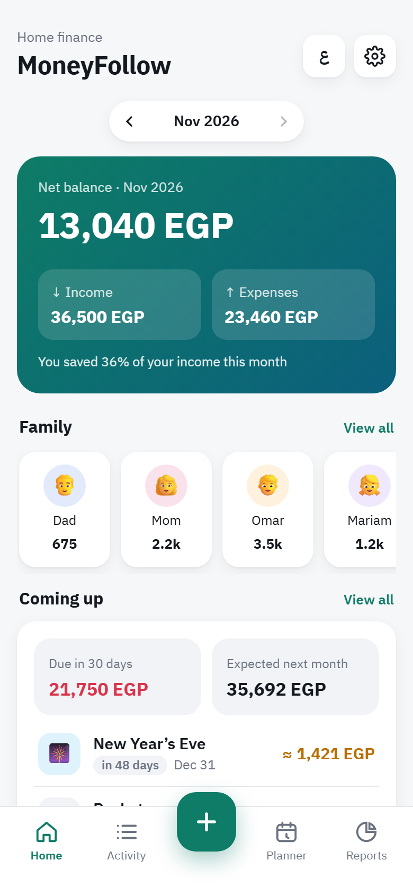</td>
<td>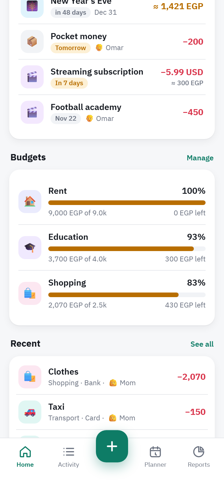</td>
<td>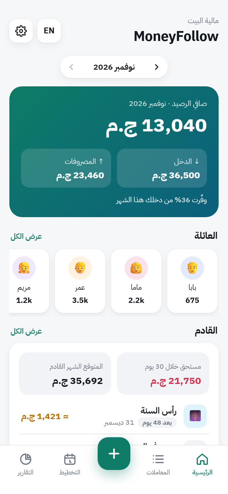</td>
</tr><tr><td align="center">Top</td><td align="center">Scrolled</td><td align="center">Arabic (RTL)</td></tr></table>

**Purpose:** a one-glance summary of the selected month and what is coming next.

| Area | Content | Action |
|---|---|---|
| Header | "Home finance", app name, language button (ع / EN), settings button. | Switch language; open Settings. |
| Month selector | ‹ November 2026 › | Change the selected month. |
| Balance card | Net balance (income − expenses), income and expense pills, and "You saved X % of your income this month" (or "You spent X % more than you earned"). | — |
| Family | One chip per member and Whole family: avatar, name, spent this month. | Open Member; "View all" opens Family. |
| Coming up | "Due in 30 days" total, "Expected next month", next occasion (countdown, date, ≈ expected), up to 3 upcoming bills with due chip and member. | Occasion row → Occasion screen; bill rows / "View all" → Planner › Recurring. |
| Budgets | The 3 categories closest to their limit. | "Manage" → Planner › Budgets. |
| Recent | Last 5 transactions of the month. | Tap to edit; "See all" → Activity. |

Empty states: "No transactions this month", "No budgets set", "Nothing due in the next 30 days", "No income recorded yet".

---

### 7.3 Activity (transactions)

<table><tr><td>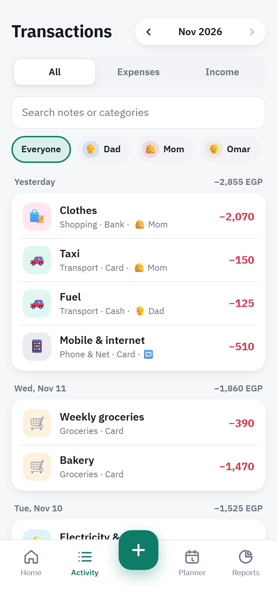</td></tr></table>

**Purpose:** see and find every transaction of the selected month.

| Area | Content | Action |
|---|---|---|
| Header | "Transactions" and month selector. | Change month. |
| Type filter | All / Expenses / Income. | Filter. |
| Search | Search notes or categories. | Filter as you type. |
| Member filter | Everyone, Whole family, each member (avatar chips, scrolls horizontally). | Filter. |
| List | Grouped by day ("Today", "Yesterday", date) with the day's net total; each row per FR-TX-10. | Tap a row to edit. |

Empty state: "Nothing found".

---

### 7.4 Transaction sheet (add / edit)

<table><tr>
<td>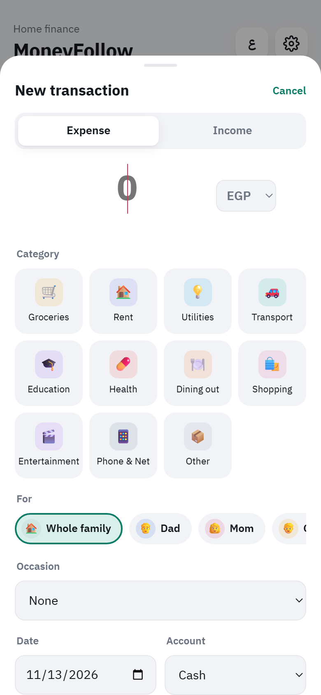</td>
<td>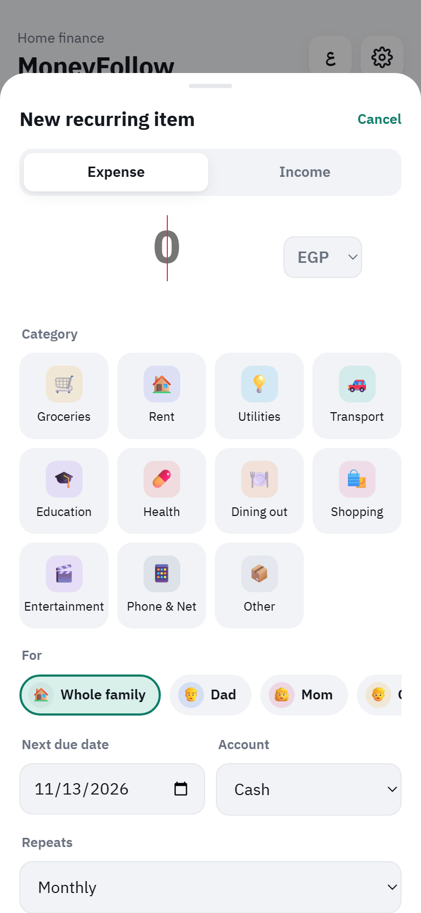</td>
</tr><tr><td align="center">New transaction</td><td align="center">New recurring item</td></tr></table>

**Purpose:** one bottom sheet for adding or editing transactions and recurring items.

| Field | Transaction | Recurring item |
|---|---|---|
| Title | New / Edit transaction | New / Edit recurring item |
| Type | Expense / Income | Expense / Income |
| Amount + currency | Large amount field, currency picker, live "≈ main currency" when different | Same |
| Category | Grid of categories for the type | Same |
| For | Whole family + each member | Same |
| Occasion | None / enabled occasions (expenses; auto-suggested) | Hidden |
| Date | Date | Next due date |
| Account | Cash, Bank, Card, Dollar account | Same |
| Repeat | Doesn't repeat / Weekly / Monthly / Every 3 months / Yearly (new transactions only) | Repeats (required) |
| Note | Note, e.g. "Weekly groceries" | Name, e.g. "House rent" |
| Buttons | Save; Delete (edit only, tap twice) | Save; Stop repeating (edit only, tap twice) |

Closing: Cancel, or tap outside the sheet.

---

### 7.5 Family

<table><tr>
<td>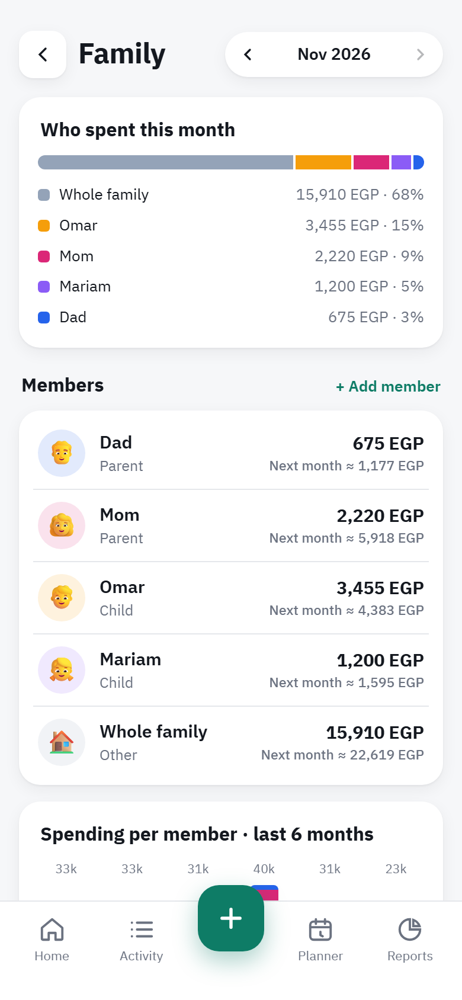</td>
<td>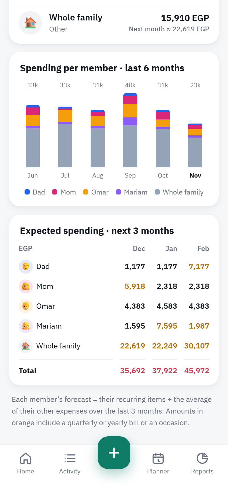</td>
</tr><tr><td align="center">Top</td><td align="center">Scrolled</td></tr></table>

**Purpose:** see how spending is split between family members, now, over time and in the coming months.

| Area | Content | Action |
|---|---|---|
| Header | Back, "Family", month selector. | — |
| Who spent this month | Share bar in member colours; legend with amount and %. | — |
| Members | Avatar, name, role, spent this month, "Next month ≈ X". | Tap → Member; "+ Add member" → Member sheet. |
| Spending per member · last 6 months | Stacked bar per month with total on top; colour legend. | — |
| Expected spending · next 3 months | Grid: members (rows) × months (columns) with a Total row. Orange cells include a quarterly/yearly bill or an occasion. | — |
| Hint | How member forecasts are calculated. | — |

---

### 7.6 Member

<table><tr>
<td>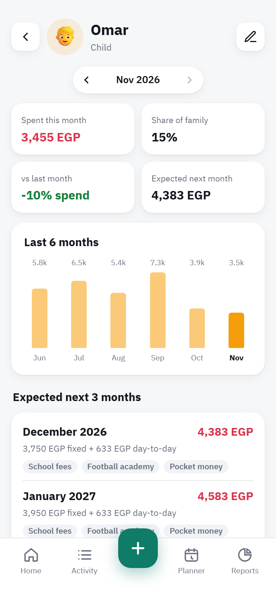</td>
<td>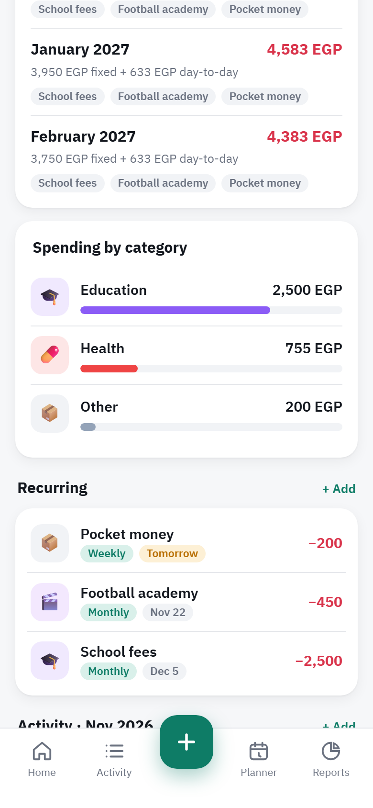</td>
</tr><tr><td align="center">Top</td><td align="center">Scrolled</td></tr></table>

**Purpose:** everything about one person's spending (also available for Whole family).

| Area | Content | Action |
|---|---|---|
| Header | Back, avatar, name, role, edit button (hidden for Whole family). | Edit → Member sheet. |
| KPIs | Spent this month, share of family, vs last month, expected next month. | — |
| Last 6 months | Bars in the member's colour, current month highlighted. | — |
| Expected next 3 months | Per month: total, "X fixed + Y day-to-day", chips for occasions and bills included. | — |
| Spending by category | Bars per category for the selected month. | — |
| Recurring | The member's recurring items with frequency and due chip. | Tap to edit; "+ Add" (member preset). |
| Activity · month | The member's transactions. | Tap to edit; "+ Add" (member preset). |

---

### 7.7 Member sheet (add / edit)

<table><tr><td>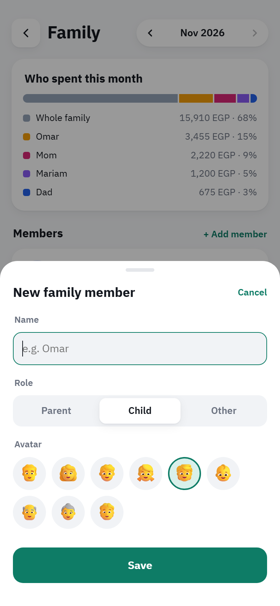</td></tr></table>

| Field | Rule |
|---|---|
| Name | Required ("Enter a name"), up to 30 characters. |
| Role | Parent / Child / Other. |
| Avatar | One of 9 emoji avatars. |
| Save | Saves; a new member gets the next unused colour. |
| Remove member | Edit only; tap twice. Hint: "Removing a member keeps their transactions and moves them to Whole family." |

---

### 7.8 Planner › Recurring

<table><tr><td>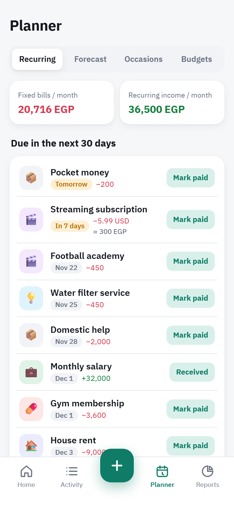</td></tr></table>

| Area | Content | Action |
|---|---|---|
| Tabs | Recurring · Forecast · Occasions · Budgets | Switch tab. |
| KPIs | Fixed bills / month, Recurring income / month. | — |
| Due in the next 30 days | Items with due chip and amount. | **Mark paid** / **Received**. |
| All recurring | Expenses and Income groups: name, frequency chip, next date, member, amount. | Tap to edit; "+ Add" → Recurring sheet. |

---

### 7.9 Planner › Forecast

<table><tr>
<td>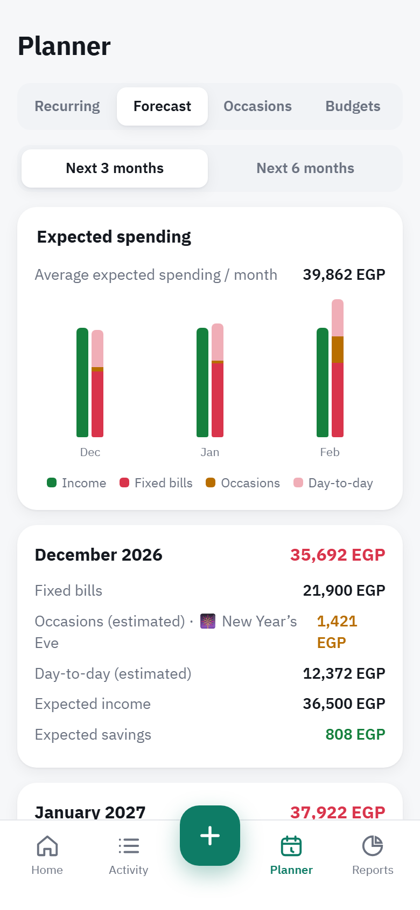</td>
<td>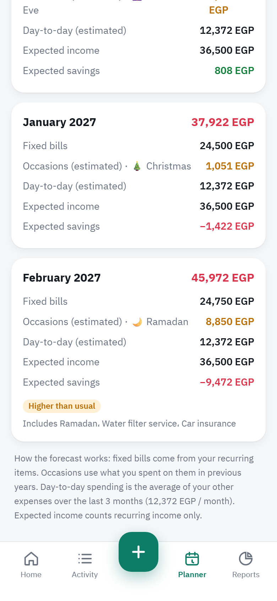</td>
</tr><tr><td align="center">Chart</td><td align="center">Month cards</td></tr></table>

| Area | Content | Action |
|---|---|---|
| Period | Next 3 months / Next 6 months. | Toggle. |
| Expected spending | Average per month; bars of income vs stacked spending (fixed, occasions, day-to-day); legend. | — |
| Month cards | Total, fixed bills, occasions (named), day-to-day (estimated), expected income, expected savings; "Higher than usual · Includes …". | — |
| Hint | How the forecast works, including the day-to-day average value. | — |

---

### 7.10 Planner › Occasions

<table><tr>
<td>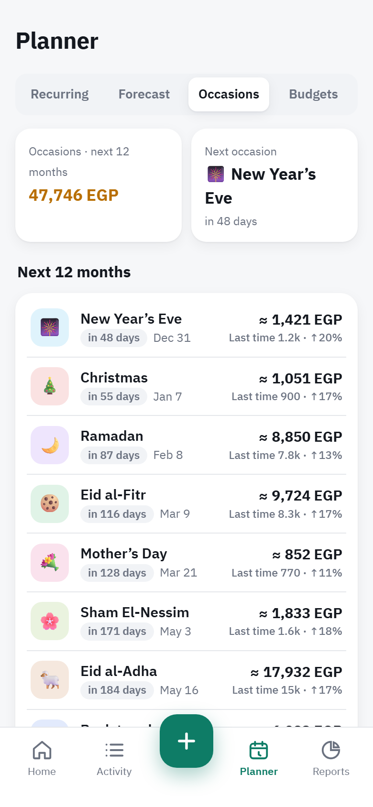</td>
<td>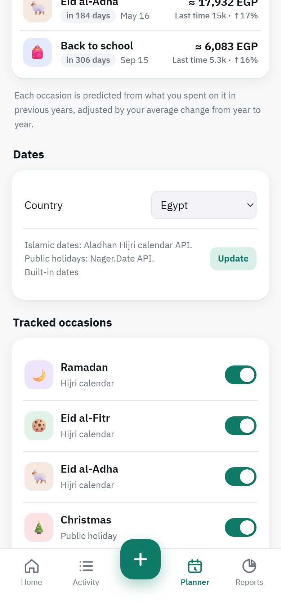</td>
<td>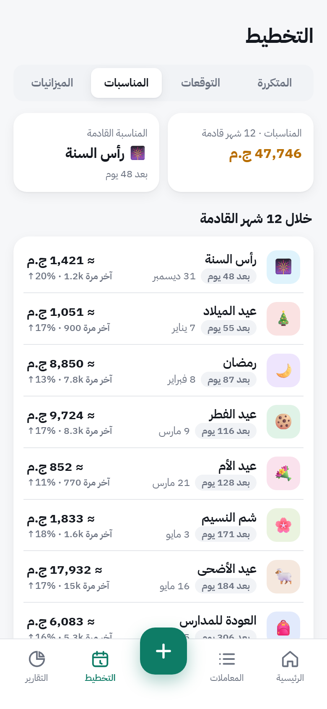</td>
</tr><tr><td align="center">Upcoming</td><td align="center">Dates source and tracked occasions</td><td align="center">Arabic</td></tr></table>

| Area | Content | Action |
|---|---|---|
| KPIs | Occasions · next 12 months (total expected), Next occasion with countdown. | — |
| Next 12 months | Each occasion: icon, name, countdown chip (orange within 30 days, "Happening now" during it), date, ≈ expected, "Last time X · ↑/↓ %". | Tap → Occasion screen. |
| Hint | How occasions are predicted. | — |
| Dates | Country picker; sources note (Aladhan, Nager.Date); "Built-in dates" / "Updated <date>". | Change country (auto-update); **Update**. |
| Tracked occasions | Every occasion available for the country, with its source (Hijri calendar, Public holiday, Fixed date) and an on/off switch. | Toggle. |

---

### 7.11 Occasion detail

<table><tr>
<td>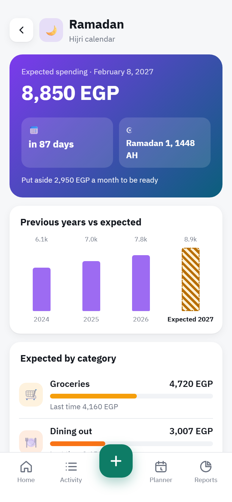</td>
<td>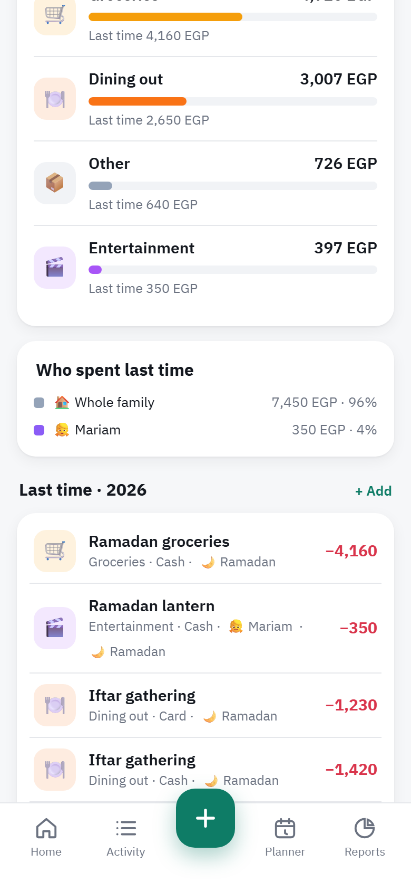</td>
</tr><tr><td align="center">Top</td><td align="center">Scrolled</td></tr></table>

| Area | Content | Action |
|---|---|---|
| Header | Back, occasion icon and name, source. | — |
| Hero (occasion colour) | Expected spending and date; days left; Hijri date (Islamic occasions) or short date; "Put aside X a month to be ready". | — |
| Previous years vs expected | One bar per past year with value, plus a striped "Expected <year>" bar. | — |
| Expected by category | Expected amount per category with "Last time X". | — |
| Who spent last time | Members with amount and %. | — |
| Last time · <year> | Last occurrence's transactions. | Tap to edit; "+ Add" (occasion preset). |
| Hint | "Expected = last time (X) × your average change between years (×g)". | — |

Empty state (no history): "No history yet. Tag expenses with this occasion and the app learns what it costs you."

---

### 7.12 Planner › Budgets

<table><tr><td>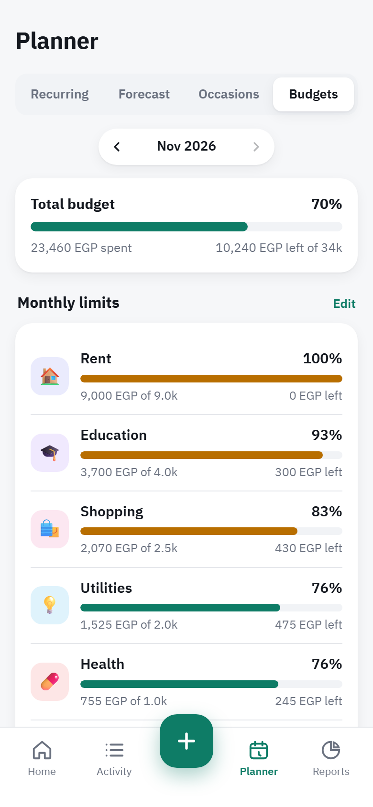</td></tr></table>

| Area | Content | Action |
|---|---|---|
| Month selector | Budgets follow the selected month. | Change month. |
| Total budget | % used, bar, "X spent", "X left of Y". | — |
| Monthly limits | One row per budgeted category (sorted by % used). | **Edit** → number inputs for all categories; **Done** saves. |

---

### 7.13 Reports

<table><tr>
<td>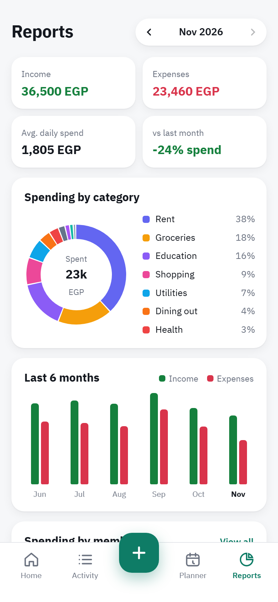</td>
<td>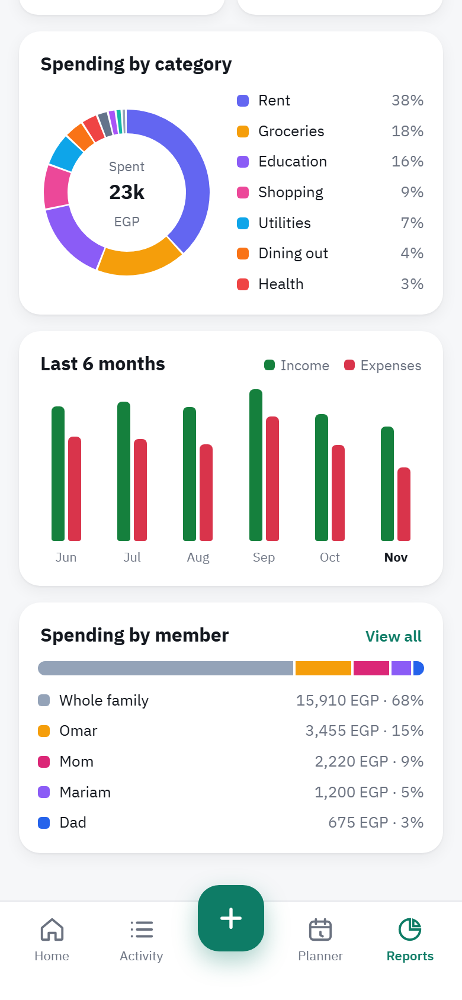</td>
</tr><tr><td align="center">Top</td><td align="center">Scrolled</td></tr></table>

| Area | Content |
|---|---|
| Header | "Reports", month selector. |
| KPIs | Income, Expenses, Avg. daily spend, vs last month. |
| Spending by category | Donut with total in the centre; legend (top 7, %). |
| Last 6 months | Income vs expense bars. |
| Spending by member | Share bar and legend; "View all" → Family. |

---

### 7.14 Settings

<table><tr>
<td>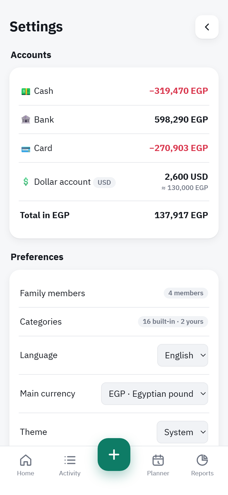</td>
<td>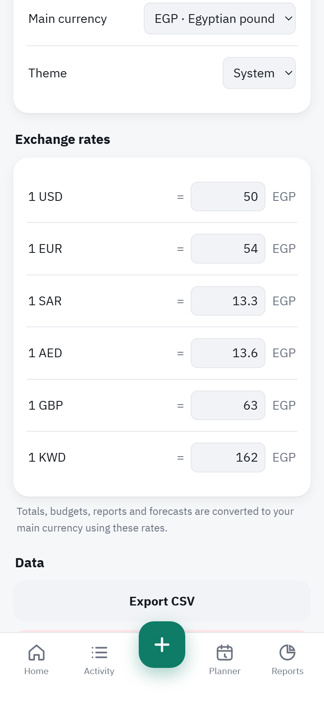</td>
</tr><tr><td align="center">Top</td><td align="center">Scrolled</td></tr></table>

| Area | Content | Action |
|---|---|---|
| Accounts | Cash, Bank, Card, Dollar account (USD chip) with balances; total in main currency. | — |
| Preferences | Family members (count), Categories ("16 built-in · 2 yours"), Language, Main currency, Theme. | Open Family / Categories; change settings. |
| Exchange rates | "1 USD = [50] EGP" for every other currency; hint. | Edit rate. |
| Data | Export CSV, Reset demo data. | — |
| Sync *(Flutter app, not in the prototype)* | Google account, sync status, Sync now, devices, Sync on Wi-Fi only, Disconnect (FR-SYNC-07). | Connect / sync / disconnect. |
| Footer | "Prototype · data is stored only in this browser". | — |

---

### 7.15 Categories

<table><tr>
<td>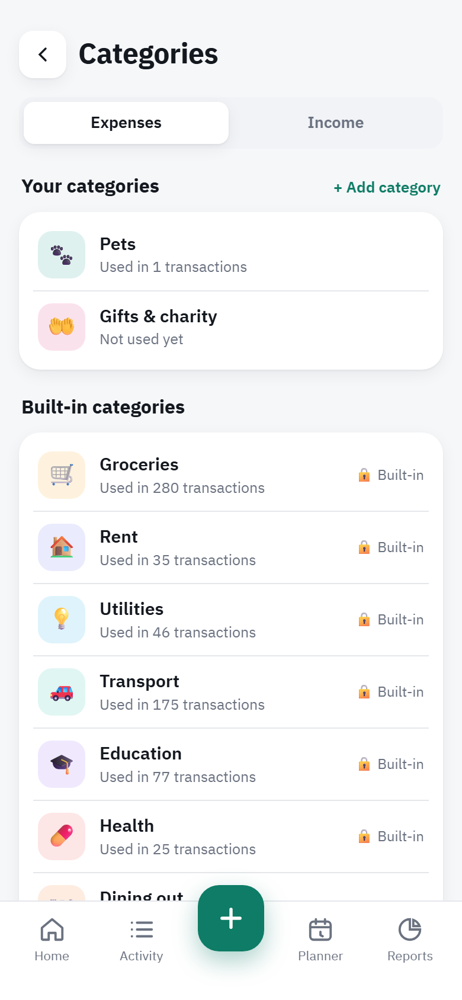</td>
<td>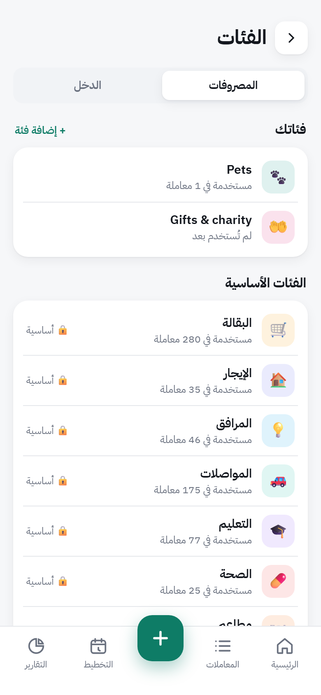</td>
</tr><tr><td align="center">English</td><td align="center">Arabic</td></tr></table>

**Purpose:** manage the user's own categories next to the fixed built-in list. Opened from Settings › Categories.

| Area | Content | Action |
|---|---|---|
| Header | Back (to Settings), "Categories". | — |
| Type | Expenses / Income. | Switch list. |
| Your categories | The user's categories of that type: icon, name, "Used in N transactions" / "Not used yet", chevron. Empty state: "No categories of your own yet. Tap “+ Add category”." | Tap → edit sheet; **+ Add category** → new sheet. |
| Built-in categories | The startup categories with usage count and 🔒 "Built-in". | None (not tappable). |
| Hint | "Built-in categories come with the app and can't be changed or deleted. Categories you add can be edited or deleted at any time." | — |

### 7.16 Category sheet (add / edit)

<table><tr>
<td>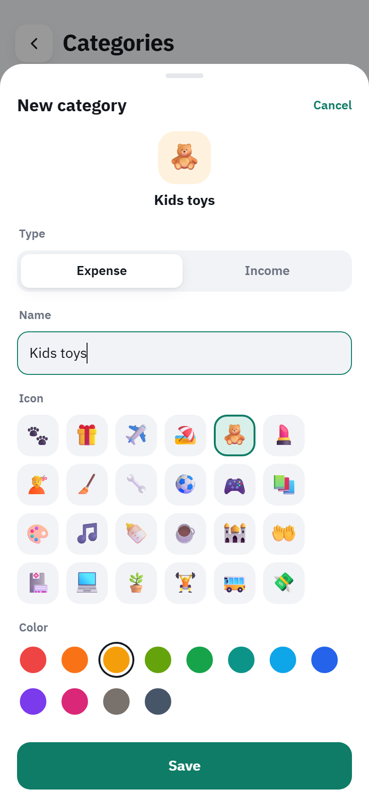</td>
<td>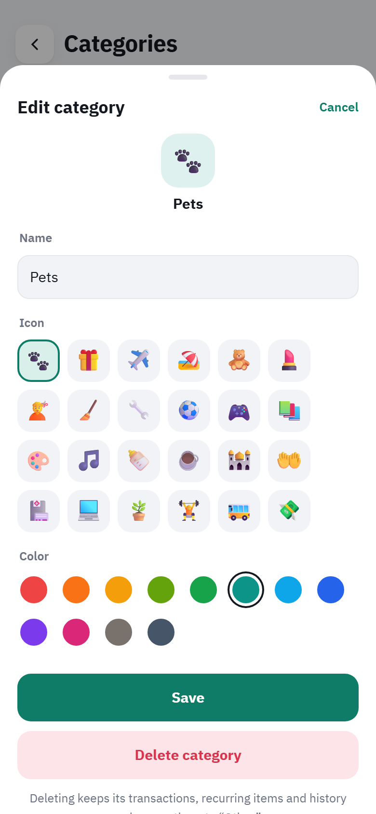</td>
</tr><tr><td align="center">New category</td><td align="center">Edit category</td></tr></table>

| Field | New | Edit |
|---|---|---|
| Preview | Large icon in the chosen colour with the name, updated live. | Same |
| Type | Expense / Income (defaults to the list the user came from). | Hidden (cannot change) |
| Name | Required, max 20, unique (FR-CAT-05). Placeholder "e.g. Pets". | Same |
| Icon | 24 icons. | Same |
| Colour | 12 colours. | Same |
| Buttons | Save. | Save; **Delete category** (tap twice). Hint: "Deleting keeps its transactions, recurring items and history and moves them to “Other”." |

**Where user categories appear:**

<table><tr>
<td>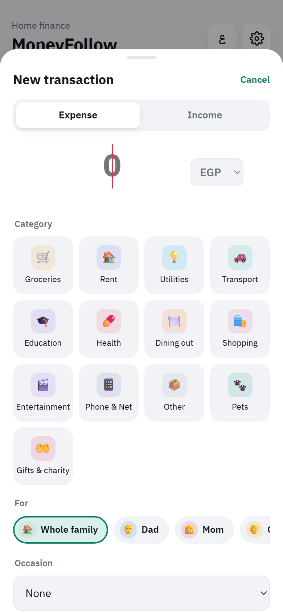</td>
<td>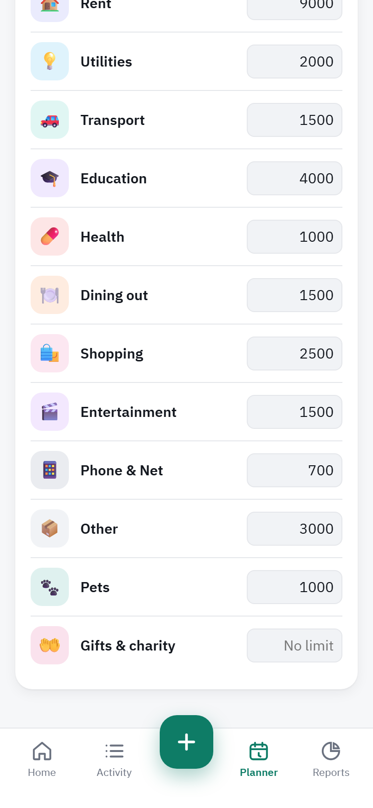</td>
</tr><tr><td align="center">Transaction sheet (after the built-in ones)</td><td align="center">Budgets › Edit</td></tr></table>

---

## 8. Data model

```
Member        id, name, role (parent|child|other), avatar, colour
Category      built-in: fixed in the app (id, en, ar, icon, colour), never stored or synced
              user:     id, type (expense|income), name, icon, colour   (stored + synced)
Transaction   id, type (expense|income), amount, currency, category, date,
              account, member (null = whole family), occasion (nullable),
              note, recurringId (nullable)
Recurring     id, type, amount, currency, category, name, frequency
              (weekly|monthly|quarterly|yearly), nextDue, dayOfMonth,
              account, member (nullable)
Budget        category → monthly limit (main currency)
Rates         currency → value of 1 unit in EGP
Occasion      id, source (hijri|holiday|fixed), Hijri month/day or match rule
              or MM-DD, length in days, countries, icon, colour
OccasionDates occasion → list of start dates (fetched or built-in)
Settings      language, theme, mainCurrency, country, enabled occasions,
              lastDatesUpdate, selectedMonth
```

Relationships: a Transaction and a Recurring item each belong to at most one Member; a Transaction can come from one Recurring item and can be tagged with one Occasion.

**Storage (Flutter app):** each entity above is a table in the local SQLite database. Every synced table also has `id` (UUID), `createdAt`, `updatedAt`, `deviceId` and `deleted`. Two extra local tables support sync:

```
SyncOutbox    seq, table, recordId, payload, createdAt   (changes not yet uploaded)
SyncState     deviceId, deviceName, lastUploadedSeq,
              lastSeenSeq per other device, lastSnapshotId, lastSyncAt
```

Prototype ids are numbers; the Flutter app uses UUIDs (FR-DB-02).

---

## 9. External services

| Service | Used for | Endpoint | Notes |
|---|---|---|---|
| **Aladhan** | Islamic occasion dates | `GET https://api.aladhan.com/v1/hToG/{DD}-{MM}-{HijriYear}` | Free, no key, CORS enabled. Calculated dates; can differ by one day from the official moon sighting. |
| **Nager.Date** | Public holidays per country | `GET https://date.nager.at/api/v3/PublicHolidays/{year}/{countryCode}` | Free, no key, CORS enabled. Has Egypt, US, UK; no data for Saudi Arabia, UAE, Kuwait. |
| **Google Sign-In + Google Drive API v3** | Sync and backup between devices | `https://www.googleapis.com/drive/v3/files` (Flutter: `google_sign_in`, `googleapis`) | Free. Needs a Google Cloud project with an OAuth consent screen for Android and iOS. Scope depends on decision D-3: `drive.appdata` or `drive.file` (both non-sensitive, no security audit needed). |
| Exchange rates | Live currency rates | *To be chosen* (production) | Prototype uses editable manual rates. |

Both date services are optional at runtime: the app must keep working with saved or built-in dates when they are unreachable.

---

## 10. Non-functional requirements

| ID | Requirement |
|---|---|
| NFR-01 | **Offline first:** all features work without internet from the local database; only date updates, Google Drive sync and live rates need a connection. |
| NFR-02 | **Performance:** every screen renders in under 300 ms with 3 years of data (~2,000 transactions). |
| NFR-03 | **Layout:** designed for phones from 360 px wide; no horizontal scrolling; bottom navigation always visible. |
| NFR-04 | **RTL:** every screen is correct in Arabic and English (see FR-L10N). |
| NFR-05 | **Accessibility:** icon-only buttons have labels; colour is never the only signal (amounts also have − / + signs, budget rows show %, chips have text). |
| NFR-06 | **Themes:** light, dark and follow-system. |
| NFR-07 | **Data safety:** changes are saved immediately; destructive actions need a second tap; deleting a member never deletes transactions. |
| NFR-08 | **Privacy:** financial data stays on the device and in the family's own Google Drive. There is no MoneyFollow server, and no personal data is sent to the date services. |
| NFR-09 | **Platforms:** Android and iOS from one Flutter code base (`src/`, package `com.ebtkar.money_follow`). |
| NFR-10 | **Distribution (testing):** release APKs are uploaded to the project Google Drive folder (see README). |

---

## 11. Production app: requirements beyond the prototype

These items came up while building the prototype and need to be in the Flutter app. They are proposals until confirmed.

| ID | Requirement | Reason |
|---|---|---|
| PR-01 | **Local database + Google Drive sync:** see §5.12 (FR-DB, FR-SYNC). Confirmed requirement. | Parents see and enter the family's spending from their own phones with no server to run. |
| PR-02 | **Child devices with limited rights:** a child's phone syncs only their own spending, pocket money and history, not the family totals. | Keeps the parent in control. Note: Drive sync cannot enforce this on its own, because anyone with access to the sync folder can read all of it (unless per-member encryption is added). |
| PR-03 | **Store the exchange rate on each transaction** at the time it is recorded. | Changing today's rate must not change the value of past transactions. |
| PR-04 | **Live exchange rates** with manual override. | Rates change often. |
| PR-05 | **Transfers between accounts** (e.g. withdraw cash from the bank, pay the card). | Without transfers, Cash and Card balances go negative. |
| PR-06 | **Adjust an occasion date by ±1 day** and **custom occasions** (FR-EV-13, FR-EV-14). | Moon sighting; family-specific events. |
| PR-07 | **Notifications:** bill due, budget at 80 % / 100 %, occasion coming in 30 days with the amount to put aside. | Act before it happens. |
| PR-08 | **Backup and restore** to a file (in addition to the Drive backup in FR-SYNC-11), and CSV import. | Users without sync; bringing existing data. |
| PR-09 | **App lock** (PIN / biometrics). | Financial data. |

---

## 12. Open decisions

| # | Decision | Options |
|---|---|---|
| D-1 | How to build Android APKs: Windows Smart App Control blocks a Flutter build tool (`impellerc.exe`) on the development PC. | (a) Turn off Smart App Control on the PC, or (b) build APKs with GitHub Actions. |
| D-2 | Negative Cash / Card balances in the sample data. | (a) Add transfers between accounts (PR-05), or (b) adjust the sample data only. |
| D-3 | Which Google accounts the family's devices use for Drive sync. | (a) **One family Google account** on every phone. The app uses its hidden app-data folder (`drive.appdata` scope). Simplest and invisible in Drive, but the app-data folder can't be shared with another account. (b) **Each parent uses their own Google account.** The owner's app creates a "MoneyFollow" folder (`drive.file` scope) and shares it with the other parent's Google account. That person must pick the folder once in Google's file picker so the app may open it. More set-up and more to test. *Recommendation: (b) if the parents use different Google accounts, otherwise (a).* |
| D-4 | Exchange-rate provider (PR-04). | To be selected. |

---

## 13. Acceptance checklist

- [ ] Adding an expense of 100 USD with main currency EGP shows "≈ 5,000 EGP" (at 1 USD = 50) and adds 5,000 to this month's expenses.
- [ ] Adding a monthly transaction creates a recurring item due one month later.
- [ ] **Mark paid** on a bill records a transaction today and moves the due date one period forward.
- [ ] Changing the main currency converts every total, budget, report and forecast.
- [ ] A budget at 85 % shows orange; at 110 % shows red with "X over".
- [ ] Adding a member with name, role and avatar shows them on Home, Family, the sheet's "For" picker and the Activity filter.
- [ ] Removing a member keeps their transactions under Whole family.
- [ ] Adding an expense dated 3 February 2027 suggests the Ramadan tag.
- [ ] With Ramadan history of several years, the Occasion screen shows previous years, an expected bar, and "Expected = last time × g".
- [ ] The forecast for February 2027 includes Ramadan in orange and is marked "Higher than usual".
- [ ] Switching off an occasion removes it from the list, Home and the forecast.
- [ ] Changing the country to United States fetches dates: Christmas moves to 25 December; Sham El-Nessim and Mother's Day disappear.
- [ ] With no internet, **Update** shows "Could not reach the date services" and existing dates stay.
- [ ] Switching to Arabic mirrors every screen and keeps amounts readable.
- [ ] Export CSV opens in Excel with Arabic text, member and occasion columns.
- [ ] Built-in categories show 🔒 "Built-in" and cannot be opened, renamed or deleted.
- [ ] Adding the expense category "Pets" 🐾 makes it available in the add sheet, Budgets › Edit, reports and search.
- [ ] Adding a category named "groceries" or "البقالة" shows "A category with this name already exists".
- [ ] Deleting "Pets" (tap twice) moves its transactions to "Other" and removes its budget; no transaction is lost.
- [ ] A category added on phone A appears on phone B after a sync.
- [ ] With no Google account connected, every feature works and data survives closing and reopening the app.
- [ ] Two phones connected to the same Drive: an expense added on phone A appears on phone B after a sync.
- [ ] Both phones offline: A edits transaction X and B edits transaction Y; after both sync, both edits are on both phones.
- [ ] Both phones edit the same transaction offline: after sync, both phones show the edit with the later time.
- [ ] A deletes a transaction; after sync it is gone on B too.
- [ ] Reinstalling the app and connecting the same Drive restores all data.
- [ ] Turning airplane mode on during a sync loses nothing; the next sync completes.

---

## Appendix A: reference lists

**Occasions**

| Occasion | Source | Date rule | Days | Countries |
|---|---|---|---|---|
| 🌙 Ramadan | Hijri (Aladhan) | 1 Ramadan | 30 | All |
| 🍪 Eid al-Fitr | Hijri (Aladhan) | 1 Shawwal | 3 | All |
| 🐑 Eid al-Adha | Hijri (Aladhan) | 10 Dhul-Hijjah | 4 | All |
| 🎄 Christmas | Public holiday (Nager.Date) | "Christmas Day"; fallback 7 Jan (Egypt) / 25 Dec | 1 | All |
| 🎆 New Year's Eve | Fixed | 31 Dec | 1 | All |
| 🌸 Sham El-Nessim | Public holiday (Nager.Date) | Easter Monday | 1 | Egypt |
| 💐 Mother's Day | Fixed | 21 Mar | 1 | EG, SA, AE, KW |
| 🎒 Back to school | Fixed | 15 Sep | 7 | All |

**Built-in Egypt dates** (fetched 14 Nov 2026)

| Occasion | 2024 | 2025 | 2026 | 2027 |
|---|---|---|---|---|
| Ramadan | 11 Mar | 1 Mar | 18 Feb | 8 Feb |
| Eid al-Fitr | 10 Apr | 30 Mar | 20 Mar | 9 Mar |
| Eid al-Adha | 16 Jun | 6 Jun | 27 May | 16 May |
| Christmas | 7 Jan | 7 Jan | 7 Jan | 7 Jan |
| Sham El-Nessim | 6 May | 21 Apr | 13 Apr | 3 May |

**Sample data used in the prototype**

- Family: Dad, Mom, Omar (son), Mariam (daughter).
- History from January 2024 to 13 November 2026, with prices rising each year.
- Recurring items include salary, flat rent received, house rent, school fees, utilities, mobile & internet, streaming (USD), gym, car insurance (yearly), water filter (every 3 months), Mariam's ballet and school books, Omar's football academy and weekly pocket money.
- Tagged spending for past Ramadans, Eids, Christmas, New Year's Eve, Sham El-Nessim, Mother's Day and back to school.
